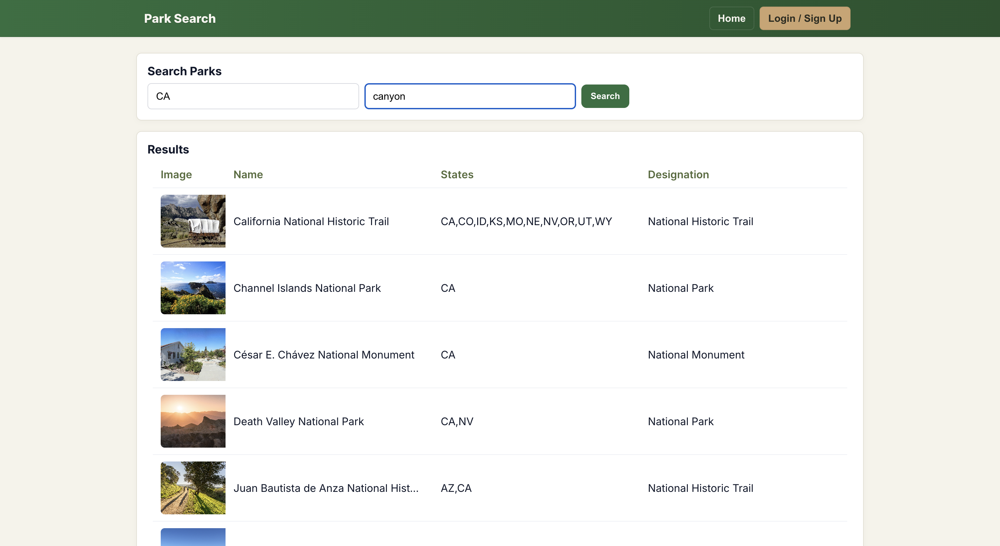
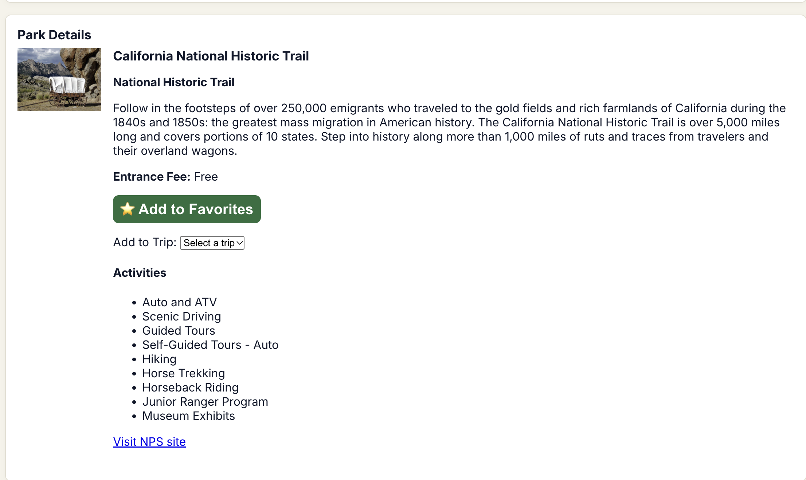
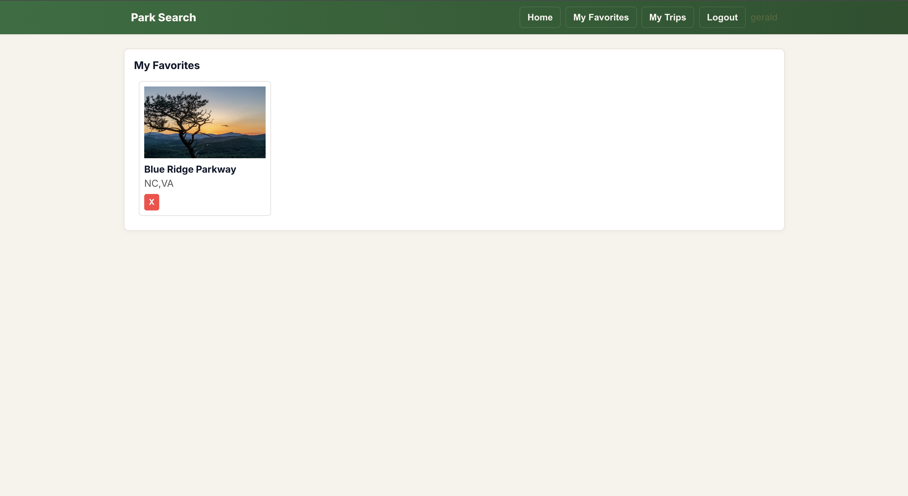
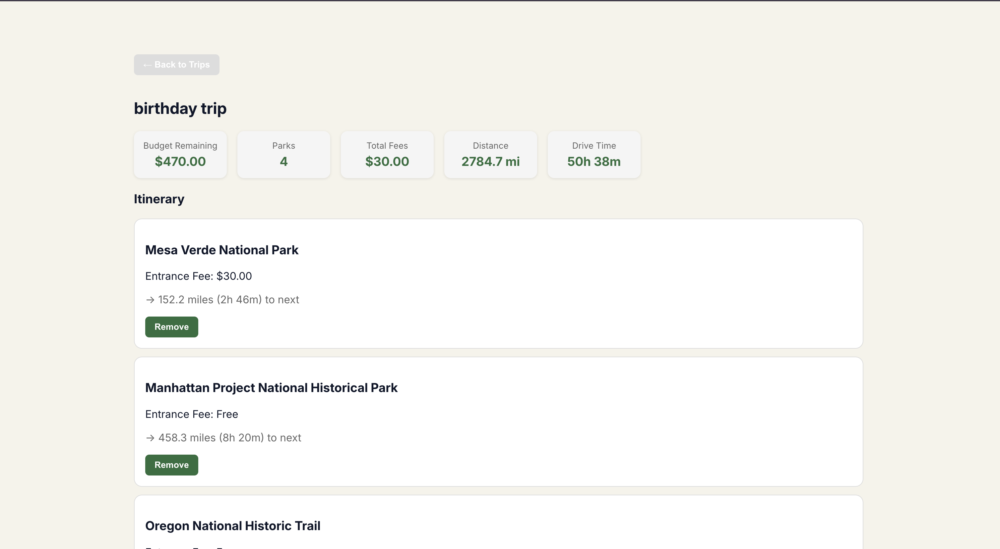
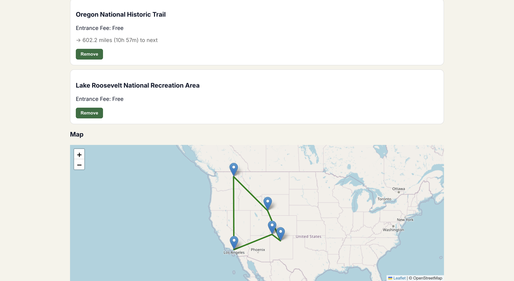

# 🏞️ National Parks Trip Planner

Search U.S. national parks, save your favorites, and plan a multi-park road trip with a running budget, total distance, and the route drawn on an interactive map.

> Built solo for USC CSCI 201 (Principles of Software Development), Spring 2026. Source code is available on request.

<!-- Replace with your own screenshots. Drag images into the GitHub editor or put them in a /docs folder -->
<p align="center">
  
  
  
  
   
</p>

## 🎥 Demo

▶️ [Watch the demo video]

https://github.com/user-attachments/assets/ae62fe9a-0188-4d76-ac0c-f846b2bcf6f7


## 📌 Overview

Planning a road trip across several national parks means juggling park info, entrance fees, and distances across different sites. This web app brings all of it into one place. It pulls live park data from the **National Park Service API**, and logged-in users can save favorites and build trips that track their remaining budget and the miles between stops.

## ✨ Features

- **Park search:** Search parks by state and/or keyword using live data from the NPS API, with photos for each result.
- **Park details:** View a park's description, entrance fee, and available activities in a details card.
- **Guest vs. logged-in experience:** Guests can browse and search. Signing up unlocks park details, favorites, and trips, and the navigation bar changes to match the login state.
- **Favorites:** Save parks to your account for later.
- **Trip planning:** Create named trips and add or remove parks in the order you'll visit them.
- **Budget tracking:** Each trip starts with a $500 budget. Adding a park subtracts its entrance fee, and removing one adds the fee back, so you always see how much is left.
- **Distance calculation:** The app computes the distance between consecutive stops and the trip's total mileage with the Haversine formula, using each park's latitude and longitude.
- **Interactive route map:** Leaflet.js places a marker on each park and draws the route between stops in visit order.

## 📱 How It Works

```
 Browser (HTML/CSS/JS)
        │  fetch() → JSON
        ▼
 ┌──────────────────────────────┐
 │  AuthFilter                  │  Protects /favorites, /trips, /details
 │  (session check → 401/redirect)
 └──────────────┬───────────────┘
                ▼
 Java Servlets on Tomcat 10.1
   /api/search    /api/details    /api/favorites
   /api/trips     /api/login      /api/register
   /api/session   /api/logout
        │                         │
        ▼                         ▼
 National Park Service API     MySQL (JDBC)
 (park data, fees,             users, favorites,
  activities, images,          trips, trip_parks
  coordinates)
```

1. The frontend calls the servlet endpoints with `fetch()` and renders the JSON responses into the page.
2. The search and details servlets call the NPS API, parse the response with **Gson**, and return only the fields the UI needs, with safe defaults for missing data.
3. A servlet **filter** checks the user's session before any protected page or API route. API calls get a `401` JSON error, and page requests are redirected home.
4. Favorites and trips are stored in MySQL using parameterized queries (`PreparedStatement`). Each trip stores its budget and its parks in visit order, along with each park's entrance fee.
5. On the trip page, the frontend calculates the distances and draws the route with Leaflet.

## 🗄️ Data Model

| Table | Purpose |
|---|---|
| `users` | Account info (unique username and email) |
| `favorites` | Saved parks per user (one row per user + park) |
| `trips` | A user's named trips, each with a budget (default $500) |
| `trip_parks` | The parks in a trip, with visit order and entrance fee |

## 🛠️ Tech Stack

| Layer | Tools |
|---|---|
| Frontend | HTML, CSS, JavaScript |
| Backend | Java, Jakarta Servlets & Filters |
| Server | Apache Tomcat 10.1 |
| Database | MySQL, JDBC |
| External API | National Park Service API |
| JSON | Gson |
| Mapping | Leaflet.js |

## 💡 What I Learned

- How to integrate an external REST API into a Java backend and turn its data into a simpler response for the frontend
- Why a JSON library like Gson is less error-prone than building JSON strings by hand
- How to use a servlet filter to protect routes and give API calls and page requests different responses
- How to use the Haversine formula to calculate real-world distances from coordinates
- Next time, I'd plan the page architecture before starting to avoid building pages I didn't use

## 🔮 Future Improvements

- Reorder trip stops by dragging, and suggest the shortest route
- Use driving distances from a routing API instead of straight-line distances
- Let users set their own starting budget

## 👤 Author

**Daisy Fregoso**: [GitHub](https://github.com/dazyfrgso) · [LinkedIn](https://www.linkedin.com/in/daisy-fregoso/)
